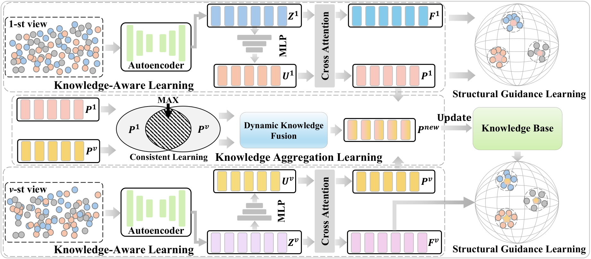

<h1 align="center">Dynamic Knowledge-Aware for Streaming View Clustering</h1>

<p align="center">
  Juan Chen<sup>†</sup>, Honglin Yuan<sup>†</sup>, Kaiyan Liao<sup>*</sup>, Wei Zhang,<br>
  Xiangli Peng, Qinggang Zhang, Xinchao Zhao, and Yuan Sun
</p>

<p align="center">
  <strong>IEEE Transactions on Image Processing (TIP)</strong><br>
  <strong>Method:</strong> Dynamic kNowledge-Aware (DNA)<br>
  <a href="https://github.com/hl-yuan/DNA">Code Repository</a>
</p>

<p align="center">
  <sup>†</sup> Equal contribution &nbsp;&nbsp; <sup>*</sup> Corresponding author
</p>

## Abstract

In real-world scenarios, heterogeneous views are often acquired sequentially, giving rise to Streaming View Clustering (SVC). Existing methods typically use view-specific knowledge to guide the learning of incoming views, while overlooking the shared, view-invariant knowledge structure. Consequently, the model may progressively forget common information across historical and current views, resulting in unstable clustering performance under different view arrival orders. To address this problem, we propose a Dynamic kNowledge-Aware (DNA) framework with an initial learning stage and a continual learning stage. First, knowledge-aware learning extracts prototype knowledge from the first view and constructs an initial knowledge base. As new views arrive, knowledge aggregation learning promotes consistency between current and historical prototypes, while dynamic knowledge fusion adaptively integrates the two knowledge sources and updates the knowledge base. Finally, structural guidance learning uses the updated knowledge to guide the feature distribution of each incoming view. Experiments on six benchmark datasets demonstrate the effectiveness of DNA in clustering sequentially arriving views and reducing sensitivity to view order.

<p align="center">
  
</p>

<p align="center">
  Overview of DNA: knowledge-aware learning, knowledge aggregation learning, and structural guidance learning.<br>
  <a href="assets/framework.pdf">View the vector framework figure</a>
</p>

## Requirements

The experiments reported in the paper used Linux, PyTorch 2.3.0, an NVIDIA RTX 4090 GPU, and 32 GB of system RAM. Python 3.10 is recommended for setting up the environment; the paper does not specify a Python version.

The implementation depends on the following packages:

```text
torch==2.3.0
numpy<2
scipy
scikit-learn
pandas
matplotlib
tqdm
einops
```

PyTorch 2.3.0 matches the paper. The NumPy upper bound is a compatibility recommendation; the remaining package versions are not pinned by the supplied project. An NVIDIA GPU is recommended for the full experiments, and the current training code selects CUDA automatically when it is available.

Create an environment and install the dependencies:

```bash
conda create -n dna python=3.10 -y
conda activate dna
python -m pip install torch==2.3.0 "numpy<2" scipy scikit-learn pandas matplotlib tqdm einops
```

For GPU training, install a CUDA-enabled PyTorch build compatible with your NVIDIA driver. Check CUDA availability with:

```bash
python -c "import torch; print('PyTorch:', torch.__version__); print('CUDA available:', torch.cuda.is_available())"
```

## Data Preparation

Place the MATLAB dataset files in `DNA_Train_main/Datasets/`. The loader resolves this directory relative to the source file, so no absolute dataset path needs to be configured.

```text
CODE/
├── README.md
├── assets/
│   ├── framework.png
│   └── framework.pdf
└── DNA_Train_main/
    ├── main.py
    ├── data_loader.py
    ├── Streaming_model.py
    ├── Streaming_train.py
    ├── Knowledge_Generation.py
    ├── network.py
    ├── Loss.py
    ├── Nmetrics.py
    ├── utils.py
    ├── TSNE.py
    └── Datasets/
        ├── oxford4.mat
        ├── ALOI_100.mat
        ├── NUS.mat
        ├── OutdoorScene.mat
        ├── ALOI_10.mat
        └── YoutubeFace_sel_fea.mat
```

Only `oxford4.mat` is included in the supplied local project. Add the other datasets before selecting their IDs.

Each `.mat` file must contain `X` (the multi-view features) and `Y` (the ground-truth cluster labels used for evaluation). For Oxford4, ALOI100, NUS, OutdoorScene, and ALOI10, `X` is a `1 × V` cell array and each cell contains an `N × d_v` feature matrix. For YTF-fea, the loader expects a `V × 1` cell array with `d_v × N` matrices and transposes each view. Samples must correspond across views. Features are min-max normalized by the loader.

## Run

From the `CODE` directory, enter the implementation directory and run Oxford4:

```bash
cd DNA_Train_main
python main.py --dataset_ids 0
```

The dataset IDs defined in `main.py` are:

| ID | Dataset | File | Views | Clusters |
|---:|---|---|---:|---:|
| 0 | Oxford4 | `oxford4.mat` | 3 | 4 |
| 1 | ALOI100 | `ALOI_100.mat` | 4 | 100 |
| 2 | NUS | `NUS.mat` | 6 | 12 |
| 3 | OutdoorScene | `OutdoorScene.mat` | 4 | 8 |
| 4 | ALOI10 | `ALOI_10.mat` | 4 | 10 |
| 5 | YTF-fea | `YoutubeFace_sel_fea.mat` | 5 | 31 |

Run multiple datasets after preparing their files:

```bash
python main.py --dataset_ids 0,4
```

Run all six datasets:

```bash
python main.py --dataset_ids 0,1,2,3,4,5
```

Explicitly specify the default training parameters:

```bash
python main.py --dataset_ids 0 --epochs 200 --batch_size 256 --feature_dim 256 --lr 0.0001
```

Display the command-line options:

```bash
python main.py --help
```

The current default dataset is Oxford4 (`--dataset_ids 0`). The help text in the supplied `main.py` incorrectly describes ID 5 as the default; the parser actually uses ID 0.

Each selected dataset is run with seeds `1, 2, 3, 4, 5`. The default configuration uses Adam, a learning rate of `1e-4`, a batch size of `256`, a latent dimension of `256`, and `200` epochs for each arriving view. Views are processed in their stored order in `X`. The number of clusters and the prototype count are configured in `data_loader.py`.

Dataset-specific structural-guidance weights (`beta2`, corresponding to the paper's lambda) and fusion coefficients (`similarity_alpha`) are read from `ALL_data` in `data_loader.py`:

| Dataset | Structural-guidance weight | Fusion coefficient alpha |
|---|---:|---:|
| Oxford4 | 1 | 0.9 |
| ALOI100 | 1 | 0.6 |
| NUS | 0.001 | 0.3 |
| OutdoorScene | 0.001 | 0.0 |
| ALOI10 | 0.1 | 0.6 |
| YTF-fea | 1 | 0.5 |

These values describe the supplied code. The fusion coefficient is configured per dataset rather than exposed as a command-line option.

Results are saved under `DNA_Train_main/logs/<dataset_name>/`. The program reports final clustering ACC, NMI, and ARI as percentages, summarizes their mean and standard deviation across the five runs, and writes a separate summary CSV containing `similarity_alpha`, `acc_mean`, `acc_std`, `nmi_mean`, `nmi_std`, `ari_mean`, and `ari_std`.

## Note

If you have any questions, please contact [Honglin Yuan](mailto:hl_yuan0822@163.com) or the corresponding author [Kaiyan Liao](mailto:liaoky@bocd.com.cn).

If you use this work, please cite:

```bibtex
@article{chenDNA,
  title   = {Dynamic Knowledge-Aware for Streaming View Clustering},
  author  = {Chen, Juan and Yuan, Honglin and Liao, Kaiyan and Zhang, Wei and Peng, Xiangli and Zhang, Qinggang and Zhao, Xinchao and Sun, Yuan},
  journal = {IEEE Transactions on Image Processing}
}
```

The citation omits year, volume, pages, and DOI because final publication metadata was not included in the supplied manuscript.
